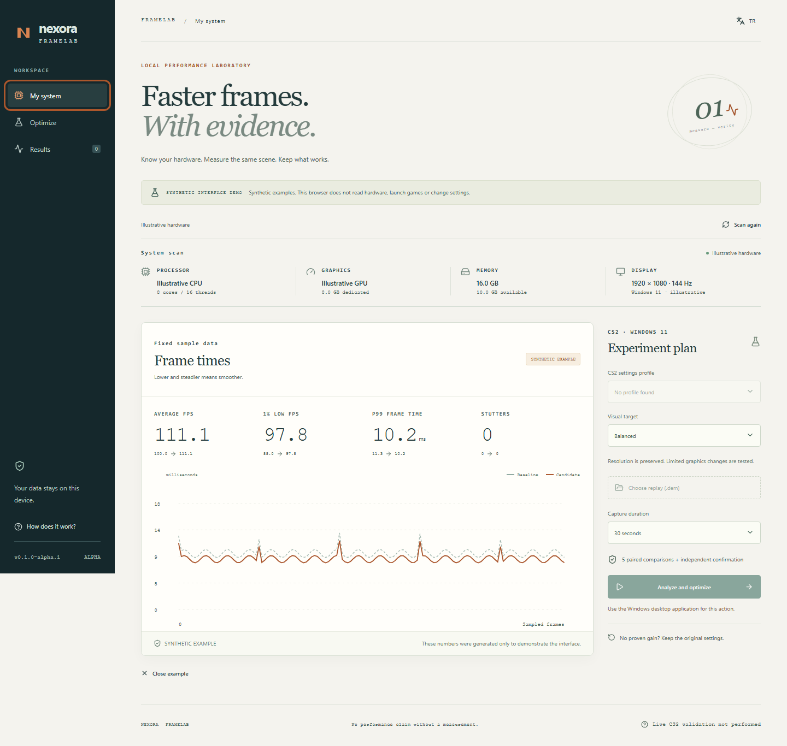

# Nexora FrameLab

**Faster frames. With evidence.**

A local Windows application that discovers your hardware, analyzes CS2 frame times and runs recoverable settings experiments. Keep a change only when paired measurements and an independent confirmation support it.

[](https://github.com/nexora-studio-tr/nexora-framelab/actions/workflows/ci.yml) · [Türkçe](README.tr.md) · [Setup](docs/SETUP.md) · [Architecture](docs/ARCHITECTURE.md) · [Validation](docs/VALIDATION.md)

**[Download 0.1.0-alpha.2 for Windows](https://github.com/nexora-studio-tr/nexora-framelab/releases/tag/v0.1.0-alpha.2)** — installer, portable ZIP, source, checksums and executed validation.

**Experimental alpha. Live CS2 testing was explicitly omitted at the operator's request. No real FPS increase or VAC/FACEIT compatibility is claimed.** The write adapter currently recognizes only `video.cfg` **Version 16** with supported fields; other versions remain read-only. Imported captures and examples cannot apply settings.

## What it does

- Discovers CPU, DXGI GPU adapters, dedicated/shared VRAM, RAM, display and Steam/CS2 installations. Missing telemetry stays unavailable.
- Reads PresentMon CSV, keeps processes/swapchains separate and reports presented FPS, 1% low, p95/p99 frame time and stutters. Displayed FPS is separate when available.
- Compares two imported captures with explicit metric, duration and quality checks. Shows observed differences only; incompatible captures withhold deltas. [How comparison works](docs/COMPARISON.md).
- Tests at most two allowlisted graphics candidates, then independently confirms the best candidate. Five paired runs per comparison, alternating A/B order; no frame-level pseudoreplication.
- Journals before writing, recovers interrupted changes, preserves unrelated edits and refuses conflicting changes. Stop and restore are part of the main interface.
- Uses a bilingual, keyboard-accessible interface. The browser demo uses synthetic data and cannot control your computer.

The experiment launcher is intentionally strict: an existing CS2 session blocks experiments; FrameLab starts only the selected local replay, targets only its owned process and requires fresh token-authenticated map telemetry. A failed launch, missing scene, changed map, incomplete capture or cancellation stops the experiment and initiates recovery. This path is implemented but **has not been validated against a live CS2 build**.

## Use the desktop application



*Interface preview; the figures are synthetic and do not show a real CS2 benchmark.*

Download the Windows installer or portable ZIP from [Releases](https://github.com/nexora-studio-tr/nexora-framelab/releases), verify `SHA256SUMS.txt`, then launch FrameLab. Windows 11 x64 and the existing Microsoft Edge WebView2 runtime are required. No account, Python, Rust or paid API is needed by end users.

1. Scan your system; select the CS2 profile if multiple profiles exist.
2. Import a PresentMon CSV for read-only analysis, or select a local `.dem` replay for an experiment.
3. Choose Balanced, Competitive or Preserve visuals. Balanced preserves resolution; Preserve is read-only.
4. Review the scope and duration. Allow the controlled experiment once, then let FrameLab measure and recover unsuccessful changes.
5. Inspect the report. Restore an applied profile with one button while CS2 is closed.

The installer is an unsigned alpha. PresentMon is included with its upstream license and verified against a pinned SHA-256. ETW capture needs Windows capture permissions; the app does not grant itself administrative access. See [setup](docs/SETUP.md).

## Try the synthetic interface demo

Node.js 24.17+ (24.x) is enough; no game or desktop build tools are needed.

```sh
git clone https://github.com/nexora-studio-tr/nexora-framelab.git
cd nexora-framelab
npm ci --ignore-scripts
npm run dev
```

Open [127.0.0.1:4367](http://127.0.0.1:4367). Choose **Explore an example**. These are explicitly **synthetic illustrative results**, not a captured benchmark or a performance promise.

## Build and verify

Desktop development requires the [official Tauri Windows prerequisites](https://v2.tauri.app/start/prerequisites/), Rust **1.99.1**, Node 24.x and Python 3 for source packaging.

```sh
npm ci --ignore-scripts
npm run prepare:tools
npm run check
cargo test -p framelab-core --locked
cargo fmt --all --check
npx playwright install chromium
npm run test:browser
npm run desktop:build
```

`framelab-cli diagnose` reads actual hardware without changing settings. `framelab-cli analyze capture.csv` performs read-only analysis; `framelab-cli example` emits an explicitly synthetic report. No game is downloaded by setup or tests.

## Data and recovery

Configuration snapshots and reports stay in the current user's local application-data directory. A raw capture is bounded and removed after analysis; importing CSV leaves the original untouched. Reports omit file paths, Steam IDs and player data. Local GSI accepts only its random-token route, retaining map name/freshness rather than player information. Export is an explicit action and never overwrites an existing file.

Recovery merges only fields changed by FrameLab. Conflicting edits, unsupported schema, unreadable files and modified temporary telemetry files require review; recovery does not silently overwrite them. If CS2 is still running after a forced app termination, close it and scan again. Backups are local, not encrypted; protect your account and device. See [security](SECURITY.md).

## Boundaries

No universal FPS percentage, registry-tweak bundle, RAM cleaner, driver installer, overclock, security disabling, game-memory writing or DLL injection. Power-plan mutation and persistent FPS-cap editing are deferred; the alpha diagnoses power state and experiments only with supported CS2 graphics fields. Replay measurements do not predict every live match. [Roadmap](docs/ROADMAP.md).

Source: **MIT**. Dependencies retain their licenses; see [third-party notices](THIRD_PARTY_NOTICES.md). [Contributions](CONTRIBUTING.md) should include reproducible, sanitized evidence.
