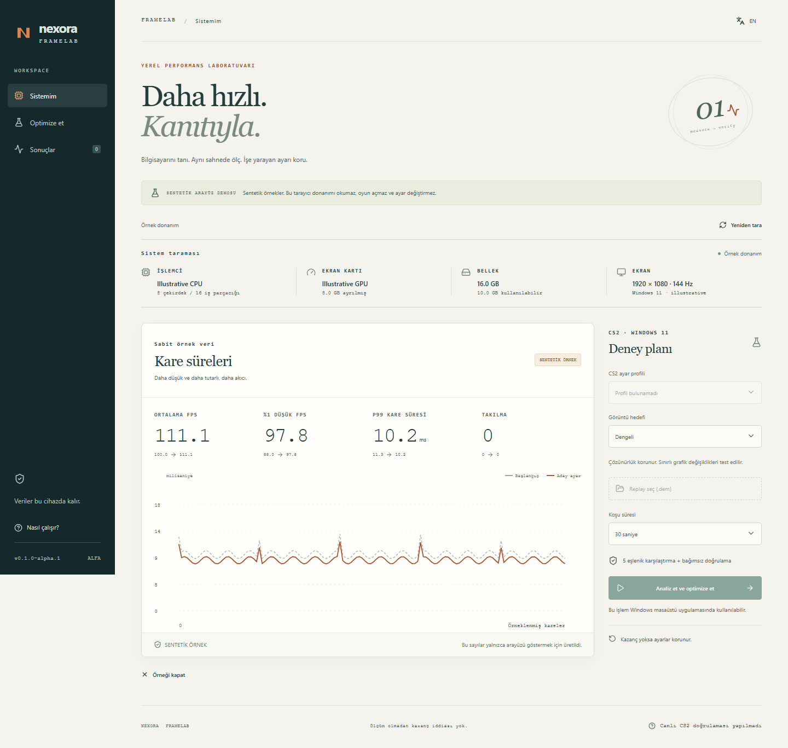

# Nexora FrameLab

**Daha hızlı. Kanıtıyla.**

Donanımını otomatik tanıyan, CS2 kare sürelerini analiz eden ve ayarları geri alınabilir deneylerle karşılaştıran yerel Windows uygulaması.

[English](README.md) · [Kurulum](docs/SETUP.md#türkçe) · [Mimari](docs/ARCHITECTURE.md) · [Doğrulama](docs/VALIDATION.md)

**[Windows için 0.1.0-alpha.2 indir](https://github.com/nexora-studio-tr/nexora-framelab/releases/tag/v0.1.0-alpha.2)** — kurulum, taşınabilir ZIP, kaynak kod, SHA-256 ve test sonuçları.

**Deneysel alfa:** Canlı CS2 testi kullanıcı isteğiyle yapılmadı. Gerçek FPS artışı veya VAC/FACEIT uyumluluğu iddia edilmiyor. Ayar yazma adaptörü yalnızca desteklenen alanları içeren `video.cfg` **Version 16** için etkin; başka sürümler salt okunur. CSV içe aktarma ve örnek sonuçlar ayar değiştiremez.

## Ne yapar?

- CPU, GPU, ayrılmış/paylaşılan VRAM, RAM, ekran ve Steam/CS2 kurulumunu bulur. Eksik sensör bilgisi uydurulmaz.
- PresentMon CSV kayıtlarında FPS, %1 düşük FPS, p95/p99 kare süresi ve takılmayı hesaplar. Farklı süreçlerin ve swapchain'lerin ölçümleri birbirine karıştırılmaz.
- İki CSV kaydını metrik türü, süre ve kalite kontrolleriyle karşılaştırır. Uyumsuz kayıtlarda yüzde farkını göstermez; gözlenen farkı performans kanıtı saymaz. [Karşılaştırma kılavuzu](docs/COMPARISON.md#türkçe).
- Uygun grafik ayarlarından en fazla iki adayı karşılaştırır. Her karşılaştırmada beş eşlenik koşu, ardından seçilen aday için bağımsız doğrulama vardır.
- Değiştirmeden önce yedekler. İptal/hata sonrası geri alır; sonradan değişmiş bir alanı körlemesine ezmez.
- Türkçe/İngilizce arayüz, klavyeyle kullanım, yerel raporlar ve sentetik arayüz demosu sunar.

## Kullanım



*Arayüz önizlemesi; sayılar sentetiktir ve gerçek CS2 performansını göstermez.*

[Sürümlerden](https://github.com/nexora-studio-tr/nexora-framelab/releases) Windows kurulum paketini veya taşınabilir ZIP'i indir; SHA-256 dosyasıyla doğrula. Windows 11 x64 ve mevcut WebView2 gerekir. Son kullanıcı için Python/Rust veya ücretli API gerekmez.

1. Sistemi tara; gerekirse CS2 ayar profilini seç.
2. Yalnızca analiz için CSV içe aktar veya deney için yerel `.dem` replay seç.
3. Dengeli, Rekabetçi veya Görüntüyü koru hedefini seç. Dengeli mod çözünürlüğü düşürmez; Görüntüyü koru salt okunurdur.
4. Deney kapsamını ve süresini görüp başlat. Oyun birkaç kez açılır/kapanır; mevcut maçta deney yapılmaz.
5. Sonucu incele; gerekirse CS2 kapalıyken eski ayarlara dön.

Deney başlatıcısı kendi açtığı süreci ve seçilen yerel replay'i kullanır; sahne telemetrisi gelmezse menü FPS'ini başarı saymaz. Bu canlı akış kodlandı fakat gerçek CS2'de doğrulanmadı. İlk denemeleri özel, yerel bir senaryoda yap. ETW ölçüm izni yoksa işlem durur; uygulama kendi kendine yönetici yetkisi eklemez.

## Arayüz demosu

Node.js 24.17+ / 24.x ile:

```sh
git clone https://github.com/nexora-studio-tr/nexora-framelab.git
cd nexora-framelab
npm ci --ignore-scripts
npm run dev
```

[127.0.0.1:4367](http://127.0.0.1:4367) adresinde **Örnek sonucu incele** düğmesini kullan. Veriler sentetiktir; tarayıcı donanımı okumaz, oyun başlatmaz veya ayar değiştirmez.

Yedekler ve raporlar cihazda kalır; oyuncu bilgileri toplanmaz. Var olan bir rapor dosyası dışa aktarmayla ezilmez. Kaynak lisansı **MIT**; [bağımlılık lisansları](THIRD_PARTY_NOTICES.md) ayrıdır.

İlk sürümde güç planı değiştirme, kalıcı FPS sınırı düzenleme, sürücü yükleme ve BIOS/overclock yoktur. Ayar motoru desteklenen CS2 grafik alanlarıyla sınırlıdır. [Ayrıntılı plan](PLAN.tr.md) hedefi; [yol haritası](docs/ROADMAP.md) uygulanan kapsam ve sonraki kapıları açıklar.
